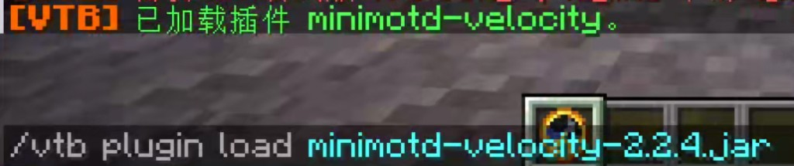
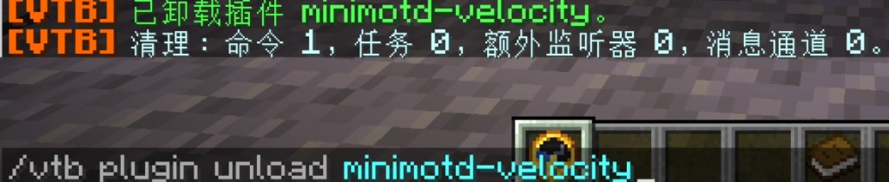
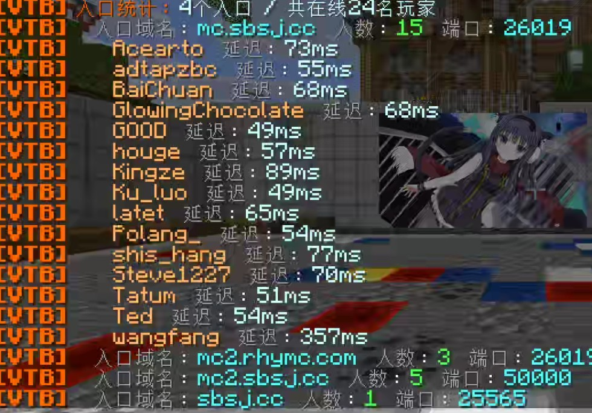
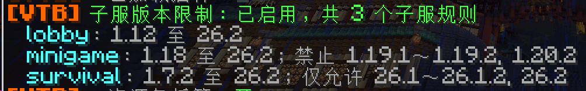

<p align="center">
  
</p>

# VelocityToolBox

**Velocity 运维工具箱：插件热管理、自定义资源包下发与托管、入口域名排查、子服客户端版本限制。**

[English](docs/README.en.md) · [Wiki 使用文档](https://github.com/polang233/VelocityToolbox/wiki) · [问题与建议](https://github.com/polang233/VelocityToolbox/issues)


## 下载与发布平台

[](https://github.com/polang233/VelocityToolbox/releases)
[](https://hangar.papermc.io/polang/VelocityToolBox)
[](https://modrinth.com/plugin/velocitytoolbox)
[](https://www.minebbs.com/resources/velocitytoolbox.18104/)
[](https://klpbbs.com/thread-173633-1-1.html)

## 特性

- **插件热管理**：查看、检查、加载、卸载和重载代理插件，并报告命令、监听器、任务等清理结果。
- **资源包下发**：按子服、客户端版本和权限选包；1.20.3+ 多包叠加，旧客户端自动选完整单包；支持必需包、切服保留和分批重发。
- **资源包托管**：内置 HTTP 下载，`@文件.zip` 自动生成链接和 SHA-1，自带限流与并发保护。
- **入口域名排查**：按玩家加入时使用的域名和端口分组显示在线玩家。
- **子服版本限制**：按子服限制客户端版本范围，无需 ViaVersion。
- **多语言**：简体中文、繁体中文、英文及自定义语言文件，消息使用 MiniMessage。

各模块默认关闭，互不依赖，按需开启。

## 安装

1. 将 JAR 放入代理的 `plugins/`，完整启动一次生成 `config.yml`。
2. 按需开启模块，替换示例中的文件和子服名，删除不用的样例。
3. 执行 `/vtb reload` 应用修改。

首次生成的 config.yml 按系统地区使用中文（大陆、港澳台）或英文注释。更新时替换 JAR 后完整重启代理；已有配置和语言文件不会被覆盖，缺少的语言键自动使用内置文本。

## 命令与权限

主命令 `/vtoolbox`，别名 `/vtb`。管理员权限 `velocitytoolbox.admin` 包含全部命令。

| 命令 | 说明 |
| --- | --- |
| `/vtb help` | 显示有权限的命令 |
| `/vtb info` | 各模块运行状态 |
| `/vtb reload` | 重载配置、语言和模块规则，不重载其它插件 |
| `/vtb plugin list\|inspect\|load\|unload\|reload` | 插件管理 |
| `/vtb pack list\|check` | 查看资源包与托管状态；检查配置但不应用 |
| `/vtb pack status <玩家>` | 玩家的加载状态与匹配原因 |
| `/vtb pack resend\|remove <玩家\|all>` | 重新下发或撤下资源包 |
| `/vtb server hosts` | 按入口域名查看在线玩家 |

细分权限按“基础 + 模块 + 动作”组合，见 [模块、命令和权限](https://github.com/polang233/VelocityToolbox/wiki/Modules)。

## 模块

### 插件管理

`load` 可省略 `.jar` 或只写部分文件名。仍被其它插件硬依赖的插件不能卸载。权限、协议及连接管理类插件建议重启代理更新。

<p align="center">
  
</p>
<p align="center">
  
</p>

### 资源包下发与托管

`resource-packs` 决定给谁发哪个包，`pack-host` 提供 ZIP 下载，两者独立开关。来源有三种写法：

- `"@文件.zip"`：取托管目录中的 ZIP，自动生成链接和 SHA-1。
- 外部 HTTP/HTTPS 直链：客户端直接下载，需填写真实 hash。
- `none`：不下发。

```yaml
resource-packs:
  enabled: true
  packs:
    survival: "@survival.zip"
  servers:
    default: keep           # 未列出的子服保留已有包
    "survival-*": [survival]
    minigame: []            # 撤下资源包
```

自托管时 `public-url` 是玩家下载地址前缀；留空自动选本机局域网地址，公网服请填可访问的 IP 或域名。托管是带限流的公开 HTTP，知道链接即可下载。

下发失败时，玩家只看到简短原因，后台记录完整诊断；用 `/vtb pack status 玩家` 排查。详见 [资源包配置](https://github.com/polang233/VelocityToolbox/wiki/Resource-Packs)。

<p align="center">
  
</p>

### 子服与入口

`/vtb server hosts` 按加入域名分组显示在线玩家、端口和延迟，点击展开玩家详情。

<p align="center">
  
</p>

`server-versions` 按子服限制客户端的版本范围、允许列表和排除列表；不提供协议转换。详见 [子服版本限制](https://github.com/polang233/VelocityToolbox/wiki/Server-Versions)。

<p align="center">
  
</p>

## 语言

`language` 留空跟随系统语言，无对应翻译时回退简体中文。见 [语言文件](https://github.com/polang233/VelocityToolbox/wiki/Language)。

## 构建

需要 Java 25：

```bash
./gradlew build
```

产物位于 `build/libs/`。`check` 包含配置解析、资源包下发、HTTP 限流和插件清理等测试，实际客户端行为仍需实服验证。维护说明见 [维护文档](docs/maintainer/README.md)。

[](https://bstats.org/plugin/velocity/VelocityToolbox/33451)
