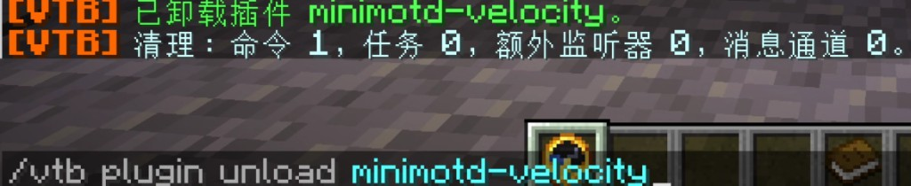
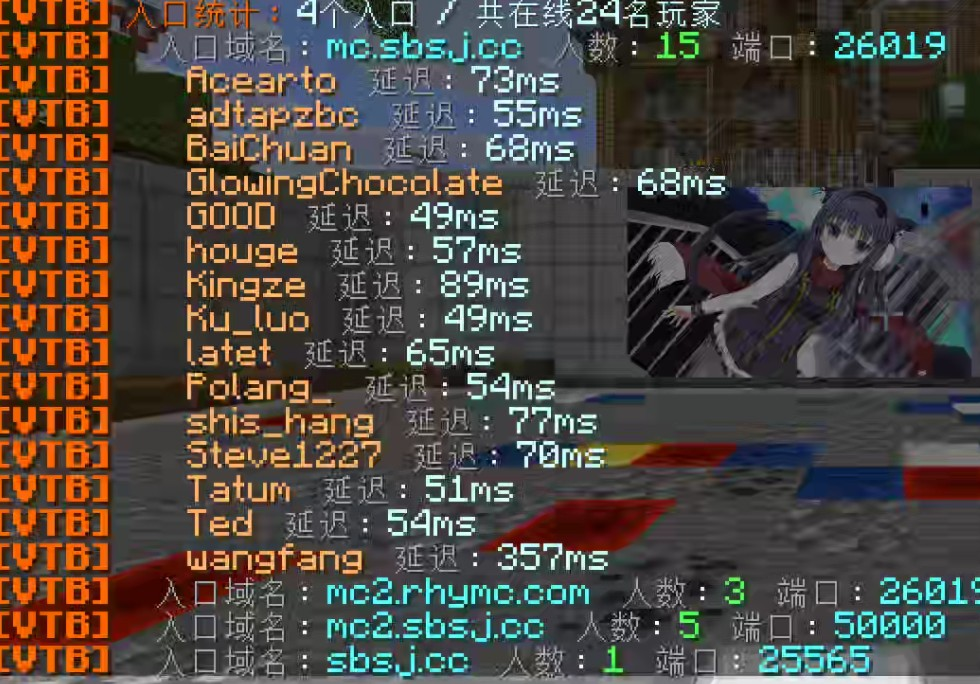
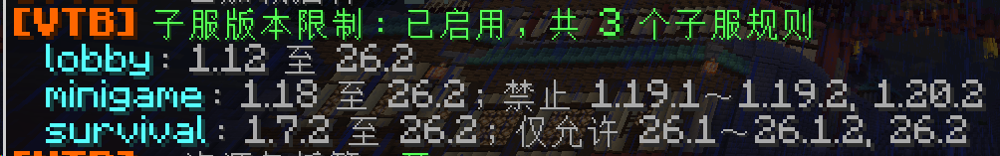

<p align="center"></p>

# VelocityToolBox

**Hot plugin management, custom resource pack delivery and hosting, entry-domain diagnostics, and per-server client version rules for Velocity.**

[中文](../README.md) · [Wiki](https://github.com/polang233/VelocityToolbox/wiki/English) · [Releases](https://github.com/polang233/VelocityToolbox/releases) · [Hangar](https://hangar.papermc.io/polang/VelocityToolBox) · [Modrinth](https://modrinth.com/plugin/velocitytoolbox) · [Issues](https://github.com/polang233/VelocityToolbox/issues)


## Features

- **Hot plugin management**: list, inspect, load, unload and reload proxy plugins, with cleanup reports for commands, listeners and tasks.
- **Resource pack delivery**: choose packs by backend, client version and permission. 1.20.3+ clients stack packs; older clients get one complete pack. Supports required packs, keeping packs across servers and batched resends.
- **Resource pack hosting**: built-in HTTP downloads. `@file.zip` gets an automatic URL and SHA-1, with rate and concurrency limits.
- **Entry-domain diagnostics**: group online players by the domain and port they joined with.
- **Server version rules**: restrict client versions per backend without ViaVersion.
- **Languages**: Simplified Chinese, Traditional Chinese, English and custom MiniMessage language files.

Every module is disabled by default and works on its own.

## Install

1. Put the JAR in the proxy's `plugins/` and start the proxy once to generate `config.yml`.
2. Enable the modules you need, replace example files and server names, and remove unused examples.
3. Run `/vtb reload`.

The generated config.yml has Chinese comments in mainland China, Hong Kong, Macau and Taiwan, and English comments elsewhere. To update, replace the JAR and restart the proxy. Existing configuration and language files are never overwritten; missing language keys fall back to bundled text.

## Commands and permissions

The command is `/vtoolbox`, alias `/vtb`. `velocitytoolbox.admin` grants every command.

| Command | Description |
| --- | --- |
| `/vtb help` | Show commands you can use |
| `/vtb info` | Module status |
| `/vtb reload` | Reload configuration, language and module rules (not other plugins) |
| `/vtb plugin list\|inspect\|load\|unload\|reload` | Plugin management |
| `/vtb pack list\|check` | Show packs and hosting; check configuration without applying it |
| `/vtb pack status <player>` | A player's load status and match reasons |
| `/vtb pack resend\|remove <player\|all>` | Resend or withdraw packs |
| `/vtb server hosts` | Online players grouped by entry domain |

Fine-grained permissions combine base, module and action nodes. See [Modules and permissions](https://github.com/polang233/VelocityToolbox/wiki/Modules-English).

## Modules

### Plugin management

`load` accepts names without `.jar` or a partial filename. Plugins that are still required by others cannot be unloaded. Restart the proxy to update permission, protocol or connection plugins.

<p align="center">
  
</p>
<p align="center">
  
</p>

### Resource pack delivery and hosting

`resource-packs` decides who gets which pack; `pack-host` serves the ZIPs. Each has its own switch. A source is one of:

- `"@file.zip"`: a ZIP in the hosting directory, with an automatic URL and SHA-1.
- An external HTTP/HTTPS URL: clients download it directly; the real hash is required.
- `none`: send nothing.

```yaml
resource-packs:
  enabled: true
  packs:
    survival: "@survival.zip"
  servers:
    default: keep           # unlisted servers keep current packs
    "survival-*": [survival]
    minigame: []            # withdraw packs
```

For hosted files, `public-url` is the download address prefix given to clients. Empty selects a local network address; public servers need a reachable IP or domain. Hosting is public HTTP with rate limits: anyone with the URL can download.

On failure, players see a short reason and the console keeps full diagnostics; use `/vtb pack status player`. See [Resource packs](https://github.com/polang233/VelocityToolbox/wiki/Resource-Packs-English).

<p align="center">
  
</p>

### Servers and entries

`/vtb server hosts` groups online players by entry domain and shows ports and latency. Click an entry for player details.

<p align="center">
  
</p>

`server-versions` restricts client versions per backend using min/max/allow/deny. It does not translate protocols. See the [Chinese version rules guide](https://github.com/polang233/VelocityToolbox/wiki/Server-Versions).

<p align="center">
  
</p>

## Language

Leave `language` empty to follow the system locale, or set `zh_cn`, `zh_tw` or `en_us`. Unsupported languages fall back to Simplified Chinese.

## Build

Requires Java 25:

```bash
./gradlew build
```

The JAR is written to `build/libs/`. `check` covers configuration parsing, pack delivery, HTTP limits and plugin cleanup; real client behavior still needs testing on a live proxy. See the [maintenance notes](maintainer/README.md).
